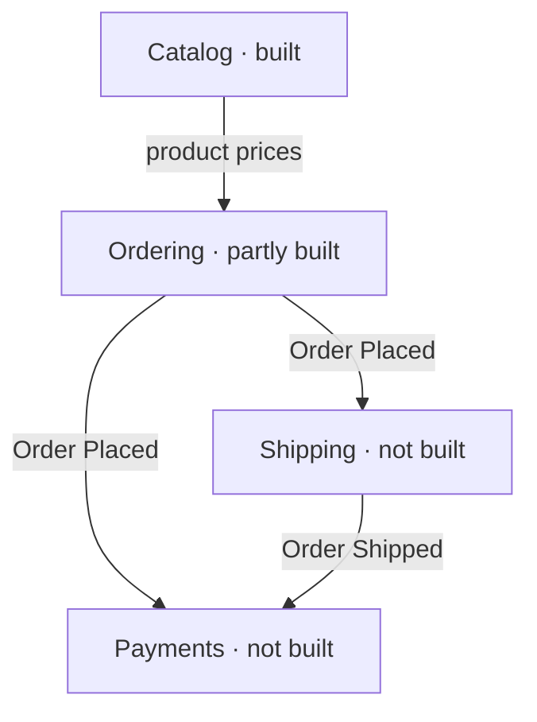
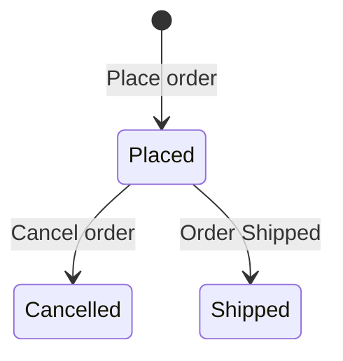

# Context map page

A context map, not a domain map. A domain map is higher level, about the business and its subdomains. The context map shows how the system actually works: what happens in each bounded context and how the contexts connect. It's the high-level reference to the system's architecture, for people and agents. It describes behavior only; what each bounded context stores goes on the Data models page.

The page is written in Notion-flavored Markdown (read `notion://docs/notion-flavored-markdown-spec` through the Notion MCP before writing). Placeholders are in braces. At setup, little is known yet: write the skeleton with one section per bounded context, mark every bounded context "not built" unless the person says otherwise, and leave the tables with a single "Nothing recorded yet" row. The worked example at the end shows a filled-in section; it's for reference, not for pasting.

## Page skeleton

Title: "Context map".

````markdown
<callout icon="🗺️" color="blue_bg">
The context map of {PRODUCT}: what happens in each bounded context and how they connect. It describes behavior only; what each bounded context stores is on <mention url="{DATA_MODELS_URL}">Data models</mention>. Words in it come from the <mention url="{GLOSSARY_URL}" type="database">Glossary</mention>.
</callout>

<quote>
"A bounded context is a subsystem in the solution space with clear boundaries that distinguish it from other subsystems. A bounded context often corresponds to a subdomain in the problem space. A bounded context also has its own set of concepts and vocabulary." — Scott Wlaschin, *Domain Modeling Made Functional: Tackle Software Complexity with Domain-Driven Design and F#* (Pragmatic Bookshelf, 2018), chapter 1, "Summarizing the Concepts of Domain-Driven Design"
</quote>

Checked against main at {COMMIT} on {DATE}

<columns>
<column ratio="60">
This page runs on two words. A **command** starts a workflow: something a person does, or something another bounded context asks for. An **event** is what the workflow announces when it's done. Other bounded contexts listen for events and never read each other's tables.
</column>
<column ratio="40">
<callout icon="🧱" color="gray_bg">
**Data models**

{ONE LINE PER BOUNDED CONTEXT: - <mention url="{BC_DATA_MODEL_URL}">{BC} data model</mention>}
</callout>
</column>
</columns>

## How the bounded contexts connect

```mermaid
flowchart TB
  {ONE NODE PER BOUNDED CONTEXT: {BC_ID}["{BC} · not built"]}
  {ONE ARROW PER EVENT OR PUBLISHED DATA: {FROM_ID} -- "{Event or data}" --> {TO_ID}}
```

{ONE "BOUNDED CONTEXT SECTION" PER BOUNDED CONTEXT, IN THE TEAM'S ORDER}

## Not on the map yet

- Nothing yet. List here what the team knows exists but hasn't placed: a workflow with no home, a word no bounded context owns, an outside system.

## Keeping this page current

- Change the map when a decision moves a boundary, adds a bounded context, or changes what crosses an edge, and link that decision.
- Check the page against the code on main: commands, events and what's built. Then update the "Checked against main" line with the commit and the date.
- Keep diagrams small and top to bottom. Edit a diagram's text in place. A new diagram opens in split view: switch it to Preview from the block's menu.
- Behavior goes here; what is stored goes on the Data models page.
````

After writing the content, add two linked views at the bottom with the create-view tool (`parent_page_id` set to this page, which appends them at the end): the Glossary as a table named "Glossary" grouped by Bounded context (`GROUP BY "Bounded context"`), and Decisions as a table named "Decisions" sorted by ADR (`SORT BY "ADR" DESC`).

## Bounded context section

`{BC_ID}` is the name without spaces, for Mermaid. `{OQ_VIEW_URL}` is the URL of the Open questions view tab filtered to this bounded context (setup creates one per bounded context).

````markdown
## {BC}

<callout icon="⚙️" color="gray_bg">
{What happens in this bounded context, in one or two sentences, in glossary words.}
</callout>

Words: {glossary terms of this bounded context as mentions, separated by commas: <mention url="{TERM_URL}">{Term}</mention>, …}

| Command | Sent by | Event it emits | Heard by, or built? |
|---|---|---|---|
| Nothing recorded yet | | | |

{ONLY FOR A WORKFLOW THAT MOVES SOMETHING THROUGH STATES: a small state diagram}

```mermaid
stateDiagram-v2
  direction TB
  [*] --> {FirstState}
  {FirstState} --> {NextState}: {Command}
```

**Across its edges**

- Sends: {events}
- Reads from other bounded contexts: {published data, and from where}
- Gives every other bounded context: {what it publishes}

<toggle>
Open questions

[Open questions in {BC}]({OQ_VIEW_URL})
</toggle>

**Words to keep apart**

| Word | Here it means | Not to be confused with |
|---|---|---|
| Nothing recorded yet | | |

Data model: <mention url="{BC_DATA_MODEL_URL}">{BC} data model</mention>
````

## Worked example (for reference only)

A made-up online shop with Catalog, Ordering, Payments and Shipping.

````markdown


## Ordering

<callout icon="⚙️" color="gray_bg">
A customer turns a Cart into an Order at checkout, and can cancel the Order until it ships.
</callout>

Words: Cart, Order, Order line, Order Placed, Order Cancelled

| Command | Sent by | Event it emits | Heard by, or built? |
|---|---|---|---|
| Place order | Customer | Order Placed | Payments, Shipping · built |
| Cancel order | Customer | Order Cancelled | Payments · not built |



**Across its edges**

- Sends: Order Placed, Order Cancelled
- Reads from other bounded contexts: product prices published by Catalog
- Gives every other bounded context: the Order ID and its Order lines, in Order Placed

**Words to keep apart**

| Word | Here it means | Not to be confused with |
|---|---|---|
| Order | What the customer asked for at checkout | Shipment: what actually leaves the warehouse |
| Cart | Products picked but not yet ordered | Order: a Cart becomes an Order only at checkout |
````
