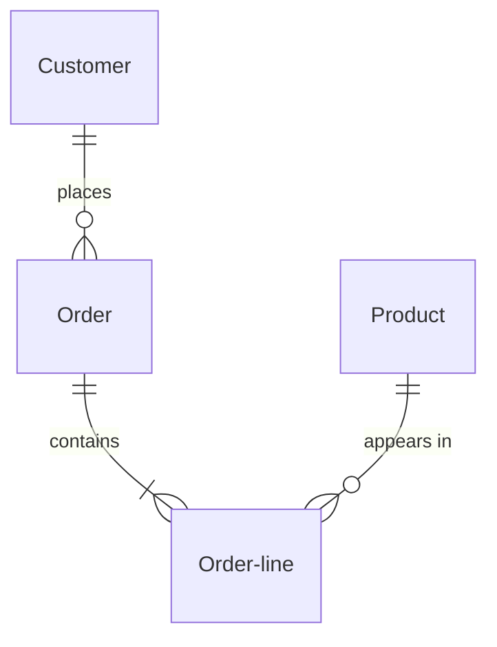

# Data models pages

An index page, "Data models", with one child page per bounded context, each holding that bounded context's conceptual entity-relationship diagram. The team fills them in as bounded contexts are built. Setup creates the index and one child page per bounded context from the templates below. Written in Notion-flavored Markdown.

What goes on a data model page:

- entities named with Glossary terms, never table names. A name that isn't in the Glossary yet gets a Proposed row first;
- their relationships and cardinality, as a Mermaid `erDiagram`;
- which bounded context owns each entity, and where an entity keeps only another bounded context's ID;
- optionally, two columns under the diagram: "Built in the product" and, for a team replacing a legacy system, "In the legacy system".

What doesn't: tables, columns or types. The code's migrations are the source of truth for the schema, and a copy in Notion goes stale with the next migration. Anyone who wants the physical schema drawn generates it from the code.

## Index page

Title: "Data models".

````markdown
Checked against main at {COMMIT} on {DATE}

<callout icon="🧱" color="gray_bg">
One conceptual entity-relationship diagram per bounded context, in Glossary words. No tables, columns or types: the code's migrations are the source of truth for the schema, and a copy here would go stale with the next migration. To see the physical schema, generate it from the code. How the bounded contexts behave and connect is on the <mention url="{CONTEXT_MAP_URL}">Context map</mention>.
</callout>

{THE CHILD PAGES, ONE PER BOUNDED CONTEXT, APPEAR HERE}
````

## Bounded context page

Title: "{BC} data model". Mermaid entity names can't contain spaces: write a multi-word glossary term with hyphens (Order-line for "Order line"). Keep the diagram small and top to bottom.

````markdown
Checked against main at {COMMIT} on {DATE}

Entities of {BC}, in Glossary words. Back to <mention url="{CONTEXT_MAP_URL}">Context map</mention>.

```mermaid
erDiagram
  {ENTITY_A} ||--o{ {ENTITY_B} : "{relationship}"
```

| Entity | Owned by | Notes |
|---|---|---|
| Nothing recorded yet | | |

{ONLY IF THE PERSON WANTS THEM: the two columns below}

<columns>
<column>
**Built in the product**

- Nothing yet
</column>
<column>
**In the legacy system**

- Not mapped yet
</column>
</columns>
````

Leave out the "In the legacy system" column when there's no legacy system.

## Worked example (for reference only)

Ordering, in a made-up online shop:

````markdown


| Entity | Owned by | Notes |
|---|---|---|
| Order | Ordering | |
| Order-line | Ordering | Keeps only the Product's ID; Catalog owns Product |
| Customer | Outside the system | Ordering keeps only the Customer's ID |
| Product | Catalog | Shown here for the relationship only |
````
